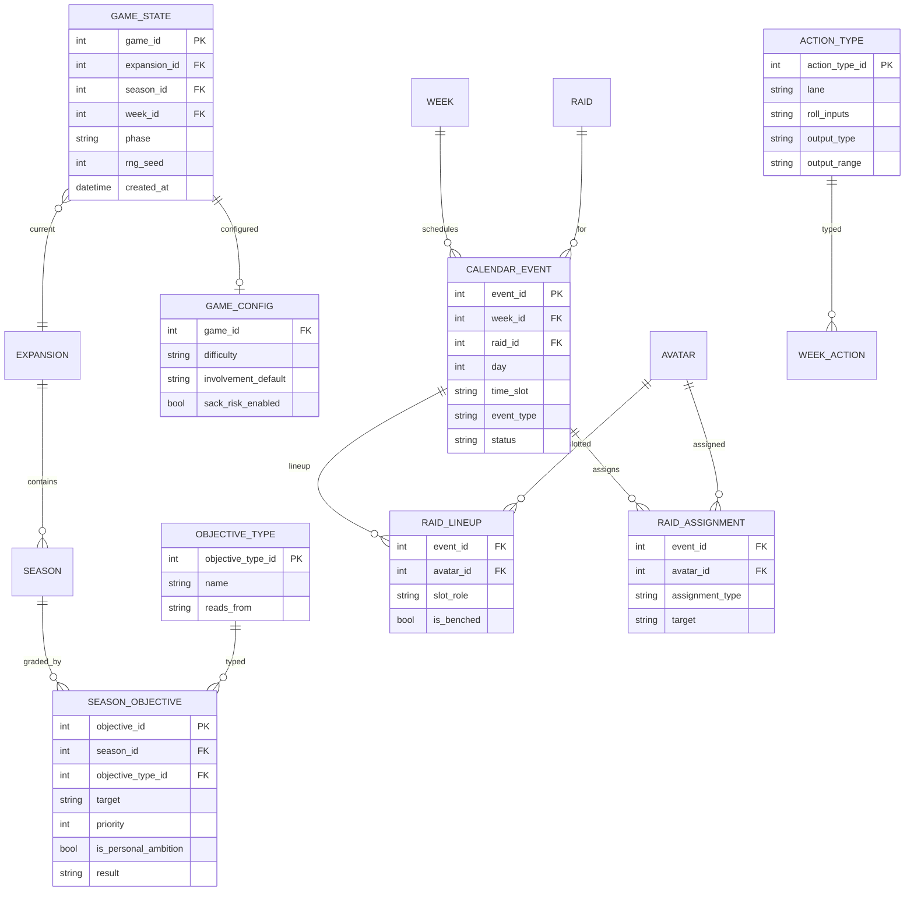

# Guildmaster: Progression Night — Data Model (ERD v0.1)

The schema behind every design decision we've locked. Split into two subject areas for legibility:

1. **Roster & Identity** — the slow-changing dimensions: who the people are, their characters, their guild.
2. **World, Content & Execution** — time, content, and the event/fact tables the raid-night engine writes to.

Render the Mermaid blocks in GitHub, dbt docs, Confluence, or [mermaid.live](https://mermaid.live).

---

## Subject Area 1 — Roster & Identity

```mermaid
erDiagram
    PLAYER ||--o{ AVATAR : plays
    PLAYER ||--o{ PLAYER_ROLE_PROFICIENCY : rated
    ROLE ||--o{ PLAYER_ROLE_PROFICIENCY : for
    PLAYER ||--o{ PLAYER_QUIRK : has
    QUIRK ||--o{ PLAYER_QUIRK : on
    PLAYER ||--o{ RELATIONSHIP : source
    PLAYER ||--o{ RELATIONSHIP : target
    LIFE_SITUATION ||--o{ PLAYER : shapes
    PLAYER ||--o{ GUILD_MEMBERSHIP : joins
    GUILD ||--o{ GUILD_MEMBERSHIP : roster
    GUILD ||--o| PLAYER : led_by
    AVATAR }o--|| CLASS : is
    AVATAR }o--|| SPEC : is
    CLASS ||--o{ SPEC : has
    SPEC }o--|| ROLE : fills
    SPEC ||--o{ SPEC_UTILITY : provides
    RAID_UTILITY ||--o{ SPEC_UTILITY : via
    SPEC ||--o{ SPEC_SYNERGY_TAG : tagged
    SYNERGY_TAG ||--o{ SPEC_SYNERGY_TAG : via
    AVATAR ||--o{ AVATAR_RESISTANCE : gears
    GUILD ||--o{ PROSPECT_ASSESSMENT : assesses
    PLAYER ||--o{ PROSPECT_ASSESSMENT : subject
    AVATAR ||--o{ AVATAR_ITEM : equips
    SLOT ||--o{ AVATAR_ITEM : in
    LOOT_ITEM ||--o{ AVATAR_ITEM : instance

    PLAYER {
        int player_id PK
        int life_situation_id FK
        string handle
        int execution
        int awareness
        int consistency
        int potential
        int growth_rate
        int ego
        int loyalty_baseline
        int loyalty_current
        int volatility
        int coachability
        int influence
        int time_budget_hrs
        int schedule_volatility
        int burnout_sensitivity
        int attendance_reliability
    }
    AVATAR {
        int avatar_id PK
        int player_id FK
        int class_id FK
        int spec_id FK
        bool is_active
        int item_level
        int gear_score
        int marks
        int familiarity
        bool hit_capped
        bool uncrittable
        datetime retired_at
    }
    LIFE_SITUATION {
        int life_situation_id PK
        string name
        string availability_window
        int volatility_mod
        int burnout_mod
        int loyalty_mod
    }
    PLAYER_ROLE_PROFICIENCY {
        int player_id FK
        int role_id FK
        int proficiency
    }
    ROLE {
        int role_id PK
        string name
    }
    QUIRK {
        int quirk_id PK
        string name
        string effect_category
        string params
        bool trait_gated
        string gate_condition
    }
    PLAYER_QUIRK {
        int player_id FK
        int quirk_id FK
    }
    RELATIONSHIP {
        int player_id_from FK
        int player_id_to FK
        int sentiment
        string rel_type
        string origin
    }
    CLASS {
        int class_id PK
        string name
    }
    SPEC {
        int spec_id PK
        int class_id FK
        int role_id FK
        string name
        int spec_difficulty
    }
    RAID_UTILITY {
        int utility_id PK
        string name
        string category
    }
    SPEC_UTILITY {
        int spec_id FK
        int utility_id FK
    }
    SYNERGY_TAG {
        int synergy_tag_id PK
        string name
    }
    SPEC_SYNERGY_TAG {
        int spec_id FK
        int synergy_tag_id FK
    }
    AVATAR_RESISTANCE {
        int avatar_id FK
        string damage_type
        int resist_rating
    }
    GUILD {
        int guild_id PK
        int guildmaster_player_id FK
        string name
        bool is_player_guild
        string progress_pace
        int reputation
        int guild_morale
        int officer_confidence
        int fairness_perception
    }
    GUILD_MEMBERSHIP {
        int membership_id PK
        int guild_id FK
        int player_id FK
        string guild_rank
        string status
        datetime joined_at
        datetime left_at
    }
    PROSPECT_ASSESSMENT {
        int guild_id FK
        int player_id FK
        string attribute
        int estimate
        int confidence
        bool revealed
    }
    AVATAR_ITEM {
        int avatar_id FK
        int slot_id FK
        int loot_item_id FK
        int item_level
    }
    SLOT {
        int slot_id PK
        string name
    }
```

## Subject Area 2 — World, Content & Execution
`PLAYER` and `AVATAR` reappear here only as join anchors (fully defined above).

```mermaid
erDiagram
    EXPANSION ||--o{ SEASON : contains
    SEASON ||--o{ WEEK : contains
    WEEK ||--o{ CALENDAR_EVENT : schedules
    SEASON ||--o{ RAID : unlocks
    RAID ||--o{ ENCOUNTER : contains
    ENCOUNTER ||--o{ LOOT_ITEM : drops
    CALENDAR_EVENT ||--o{ PULL : runs
    ENCOUNTER ||--o{ PULL : attempted
    PULL ||--o{ PULL_PARTICIPANT : includes
    AVATAR ||--o{ PULL_PARTICIPANT : as
    PULL ||--o{ PULL_CONSUMABLE : burns
    CONSUMABLE ||--o{ PULL_CONSUMABLE : used
    PULL ||--o{ LOOT_DROP : yields
    LOOT_ITEM ||--o{ LOOT_DROP : instance
    PLAYER ||--o{ LOOT_DROP : awarded
    WEEK ||--o{ PLAYER_WEEK_STATE : snapshots
    PLAYER ||--o{ PLAYER_WEEK_STATE : of
    CALENDAR_EVENT ||--o{ EVENT_AVAILABILITY : checks
    PLAYER ||--o{ EVENT_AVAILABILITY : for
    WEEK ||--o{ DRAMA_EVENT : during
    ENCOUNTER ||--o{ ENCOUNTER_PHASE : has
    ENCOUNTER ||--o{ ENCOUNTER_EVENT : places
    ENCOUNTER_PHASE ||--o{ ENCOUNTER_EVENT : scopes
    EVENT_TYPE ||--o{ ENCOUNTER_EVENT : typed
    PULL ||--o{ PULL_EVENT : logs
    ENCOUNTER_EVENT ||--o{ PULL_EVENT : fires
    AVATAR ||--o{ PULL_EVENT : targets
    GUILD ||--o{ GUILD_ENCOUNTER_PROGRESS : learns
    ENCOUNTER ||--o{ GUILD_ENCOUNTER_PROGRESS : tracked
    GUILD ||--o| GUILD_CONFIG : configured
    GUILD ||--o{ PLAYER_LOOT_STANDING : ledger
    PLAYER ||--o{ PLAYER_LOOT_STANDING : standing
    LOOT_DROP ||--o{ LOOT_CLAIM : contested
    PLAYER ||--o{ LOOT_CLAIM : claims
    GUILD ||--o| GUILD_TREASURY : holds
    GUILD ||--o{ GUILD_STOCKPILE : stocks
    CONSUMABLE ||--o{ GUILD_STOCKPILE : of
    GUILD ||--o{ TREASURY_LEDGER : logs
    WEEK ||--o{ TREASURY_LEDGER : during
    GUILD ||--o{ WEEK_ACTION : plans
    WEEK ||--o{ WEEK_ACTION : during

    EXPANSION {
        int expansion_id PK
        string name
        int release_order
        int season_length_weeks
        string difficulty_band
    }
    SEASON {
        int season_id PK
        int expansion_id FK
        string name
        int tier_order
    }
    WEEK {
        int week_id PK
        int season_id FK
        int week_number
    }
    RAID {
        int raid_id PK
        int season_id FK
        string name
        bool attunement_required
        int raid_size
    }
    ENCOUNTER {
        int encounter_id PK
        int raid_id FK
        string name
        int boss_order
        string resistance_type_check
        int resistance_threshold
        int dps_check
        int healing_check
        int phase_count
        int difficulty
    }
    LOOT_ITEM {
        int item_id PK
        int encounter_id FK
        string name
        string slot
        int item_level
        int role_id
        int marks_cost
        string spec_fit_tag
    }
    CONSUMABLE {
        int consumable_id PK
        string name
        string type
        string tier
        int cost
    }
    PULL {
        int pull_id PK
        int event_id FK
        int encounter_id FK
        int attempt_number
        string outcome
        int duration_sec
        string wipe_reason
    }
    PULL_PARTICIPANT {
        int pull_id FK
        int avatar_id FK
        int role_assigned
        string assignment_target
        int raw_contribution
        int performance_rating
    }
    PULL_CONSUMABLE {
        int pull_id FK
        int avatar_id FK
        int consumable_id FK
    }
    LOOT_DROP {
        int drop_id PK
        int pull_id FK
        int item_id FK
        int awarded_to_player_id FK
        string loot_method
    }
    PLAYER_WEEK_STATE {
        int player_id FK
        int week_id FK
        int morale
        int fatigue
        int form
    }
    EVENT_AVAILABILITY {
        int event_id FK
        int player_id FK
        bool available
        string reason
    }
    DRAMA_EVENT {
        int event_id PK
        int week_id FK
        string event_type
        string trigger
        string involved_player_ids
        string resolution_choice
        int morale_delta
    }
    ENCOUNTER_PHASE {
        int phase_id PK
        int encounter_id FK
        int phase_order
        string name
        string entry_condition
    }
    EVENT_TYPE {
        int event_type_id PK
        string name
        string trigger
        string target_selector
        string roll_attribute
        string effect_category
        string log_template
    }
    ENCOUNTER_EVENT {
        int encounter_event_id PK
        int encounter_id FK
        int phase_id FK
        int event_type_id FK
        int severity
        int weight
    }
    PULL_EVENT {
        int pull_event_id PK
        int pull_id FK
        int encounter_event_id FK
        int phase_id FK
        int target_avatar_id FK
        int sequence_no
        string roll_result
        string outcome
        string log_line
    }
    GUILD_ENCOUNTER_PROGRESS {
        int guild_id FK
        int encounter_id FK
        int progress
        int attempt_count
        int best_attempt_pct
        datetime first_kill_at
    }
    GUILD_CONFIG {
        int guild_id FK
        string active_loot_system
        string loot_config_params
        string provision_policy
        string contribution_policy
        string repair_policy
    }
    PLAYER_LOOT_STANDING {
        int guild_id FK
        int player_id FK
        int standing_value
        string standing_type
        datetime updated_at
    }
    LOOT_CLAIM {
        int claim_id PK
        int drop_id FK
        int player_id FK
        int upgrade_magnitude
        int perf_snapshot
        int loyalty_snapshot
        int attendance_snapshot
        string spec_priority
        bool progression_need
        int drought_weeks
        bool was_awarded
    }
    GUILD_TREASURY {
        int guild_id FK
        int gold
        int mats
    }
    GUILD_STOCKPILE {
        int guild_id FK
        int consumable_id FK
        int quantity
    }
    TREASURY_LEDGER {
        int ledger_id PK
        int guild_id FK
        int week_id FK
        string txn_type
        string resource_type
        int amount
        int source_player_id FK
    }
    WEEK_ACTION {
        int action_id PK
        int guild_id FK
        int week_id FK
        string lane
        string target_ref
        int time_cost
        string output_type
        int output_qty
        string outcome
    }
```



## Subject Area 3 — Campaign, Calendar, Objectives & Raid Prep
The turn/campaign layer (v0.7). `EXPANSION`, `SEASON`, `WEEK`, `RAID`, `AVATAR` reappear only as join anchors (defined above). **`RAID_NIGHT` is now modeled as `CALENDAR_EVENT` with `event_type = 'raid'`;** its raid-specific children (`PULL`, availability, lineup, assignments) key off `event_id`.



---

## Entity Reference (grain & purpose)

**People & personality**
- **PLAYER** — the human; *persists forever*. Holds all durable **traits** (skill facets, psychology, real-life knobs). Grain: one row per person.
- **LIFE_SITUATION** — preset (parent / student / shift-worker…) that *sets* the real-life knobs at generation. Trade-offs, not tiers.
- **PLAYER_ROLE_PROFICIENCY** — bridge; a human can be a natural tank *and* a passable healer. One row per (player, role).
- **QUIRK** / **PLAYER_QUIRK** — the authored library (~20–25) and its 0–3 attachments per player. Quirks sit on the **Player** because they're human behavior, not gear.
- **RELATIONSHIP** — the chemistry graph. Directed (`from → to`) so one-sided grudges work ("no healz"). Grain: one row per ordered pair that matters. *(v0.8: ships in v1 **write-only** — coach/social/referral/poach events write it; resolution chemistry effects arrive v1.1.)*

**Characters & kit**
- **AVATAR** — the character; *swappable*. One **active** per player; re-rolls retained as inactive history. Holds gear power, the two readiness caps, and **familiarity** (resets on re-roll).
- **CLASS / SPEC / ROLE** — kit lookups. `SPEC.role_id` derives the role; `SPEC.spec_difficulty` is the lever that makes human skill matter.
- **RAID_UTILITY / SPEC_UTILITY** — what a spec brings (battle-rez, haste burst, interrupt, dispel). Drives "bring the class, not the player."
- **SYNERGY_TAG / SPEC_SYNERGY_TAG** — comp/meta pairings (caster-cleave, mana-battery…).
- **AVATAR_RESISTANCE** — situational resist gear per damage type; checked against the boss, not a permanent stat.

**Guild & roster**
- **GUILD** — a guild (yours or a rival). Holds server `reputation` plus the volatile `guild_morale` / `officer_confidence` (the sacking meter). Ghost rivals *(v0.8)*: `is_player_guild=false` + `progress_pace` — their tier progression advances on a curve into `GUILD_ENCOUNTER_PROGRESS`, so **server standings are a derived view** over a table that already exists.
- **GUILD_MEMBERSHIP** — bridge Player↔Guild over time (rank, status, join/leave). This *is* the roster.

**World & time**
- **EXPANSION → SEASON → WEEK → CALENDAR_EVENT** — the nested clock (see Subject Area 3). `CALENDAR_EVENT.status = cancelled` when availability is too thin.

**Content**
- **RAID / ENCOUNTER** — instances and bosses; `ENCOUNTER` carries the fight **demands** (resistance check, dps/healing check, phases, difficulty) the engine reads.
- **LOOT_ITEM / CONSUMABLE** — drop tables and the consumable catalogue (with tier + cost for the per-fight economy).

**Execution & state (facts)**
- **PULL** — one attempt; outcome + wipe reason. Grain: one row per attempt.
- **PULL_PARTICIPANT** — **the core fact.** One row per avatar per pull; `performance_rating` (1–10) is the *output of the resolution formula*.
- **PULL_CONSUMABLE** — what was actually burned on this pull (per-fight consumable decision).
- **LOOT_DROP** — item instances and who they went to, tagged with the `loot_method` used.
- **PLAYER_WEEK_STATE** — periodic snapshot of morale / fatigue / form.
- **EVENT_AVAILABILITY** — the availability roll, per (event × player).
- **DRAMA_EVENT** — the drama log (loot / wipe / rivalry / life triggers, choice made, morale delta).

**Encounter authoring & resolution (v0.2)**
- **ENCOUNTER_PHASE** — the fight's phases (order, entry condition e.g. boss HP %). Structures the timeline the engine walks.
- **EVENT_TYPE** — the reusable event palette (avoidable death, clutch save, interrupt check…) as seed data: trigger, target selector, roll attribute, effect, `log_template`.
- **ENCOUNTER_EVENT** — bridge placing an EVENT_TYPE into a specific encounter/phase with tuned `severity` + `weight`. *Authoring bosses = adding rows, not code.*
- **PULL_EVENT** — the combat-log fact: one row per event that actually fired in a pull (target, roll, outcome, rendered `log_line`). Powers the live feed and replay.
- **GUILD_ENCOUNTER_PROGRESS** — the learning arc: per (guild, encounter), how well this guild has learned this boss (`progress`, `attempt_count`, `best_attempt_pct`, `first_kill_at`). Persists across nights.

*Also updated:* `PULL_PARTICIPANT.performance_score` → **`performance_rating`** (1–10 vs expected) plus **`raw_contribution`** (underlying number, for logs + MVP math).

**Loot & fairness (v0.3)**
- **GUILD_CONFIG** *(v0.8 merge)* — per-guild standing config: the active loot policy (council / dkp / roll) + params, and the economy policies (provision / contribution / repair). Pluggable: swapping the loot system swaps the *culture* the guild judges you by.
- **PLAYER_LOOT_STANDING** — the points ledger for economy systems (DKP/EPGP): `standing_value` + `standing_type`, per (guild, player). Absent for council/roll.
- **LOOT_CLAIM** — the per-drop decision context: one row per eligible claimant per drop, snapshotting the 7 factors (upgrade, perf, loyalty, attendance, spec priority, progression need, drought) + `was_awarded`. The audit trail that powers history + drama.
- *Also updated:* `GUILD.fairness_perception` (the culture meter, feeds retention + sacking) and `PLAYER.loyalty_baseline` / `loyalty_current` (durable trait vs drifting state — the pattern for any trait management can move).

**Economy & between-nights (v0.4)**
- **GUILD_TREASURY** — the bank: `gold` + abstract `mats` (scalars in v1). Funded by donations, raid proceeds, farming surplus.
- **GUILD_STOCKPILE** — itemized consumable buffer per (guild, consumable). What the raid burns per fight; runs dry → the shortfall event fires.
- **TREASURY_LEDGER** — every income/expense event (donation / proceeds / farming / provision / repair / purchase), with `source_player_id` for donations. The audit trail — observability for where the gold went.
- **WEEK_ACTION** — the weekly plan as data: one row per management action taken (lane, target, time cost, outcome). Drives the loop + history.

**Recruitment & scouting (v0.5)**
- **PROSPECT_ASSESSMENT** — the fog-of-war overlay: per (guild × prospect × attribute), the current `estimate`, `confidence`, and `revealed` flag. Truth lives on `PLAYER`; display applies noise scaled by confidence until revealed. A prospect is just a `PLAYER` with `GUILD_MEMBERSHIP.status` = applicant/trial. *Truth dimension + a per-guild known-state fact that converges on truth as evidence accumulates.*

**Gear (v0.7)**
- **AVATAR_ITEM** — equipped gear per (avatar × slot): the item + its level. `Avatar.gear_score` = derived+cached aggregate of these; awarding loot equips-if-upgrade → power rises by the slot delta.
- **SLOT** — the 7 equipment slots (Head, Shoulder, Chest, Hands, Legs, Feet, Weapon). *`Avatar.hit_capped`/`uncrittable` derive from the equipped set, not manual flags.*
- *Also updated:* `LOOT_ITEM.marks_cost` (catch-up vendor gear) + `spec_fit_tag` (fit multiplier → the "not for me" loot argument); `Avatar.marks` (per-raider catch-up currency).

**Campaign, calendar & prep (v0.7)**
- **GAME_STATE** — the singleton save root: current expansion/season/week, `phase`, `rng_seed` (reproducible campaigns). The DB *is* the save; no `campaign_id` on every table.
- **GAME_CONFIG** *(v0.8)* — campaign settings on the save root: difficulty, involvement defaults, sack-risk toggle.
- **CALENDAR_EVENT** — one scheduled event per (week × day × `time_slot` — afternoon/evening/late, where life-situation windows bite): `event_type` (raid/dungeon/rest/social), `status`, optional `raid_id`. **Supersedes `RAID_NIGHT`** as the base; a raid night is `event_type='raid'`.
- **SEASON_OBJECTIVE** — the season mandate: type, target, priority, `is_personal_ambition`, post-grading `result`. Graded at season-end → feeds `officer_confidence` + `reputation`.
- **OBJECTIVE_TYPE** — the composable objective palette (progression/competitive/roster/cohesion/economic/development) as seed data, with `reads_from` naming its source system.
- **RAID_LINEUP** — tonight's roster per (event × avatar): `slot_role` + `is_benched`. `PULL_PARTICIPANT` inherits from it.
- **RAID_ASSIGNMENT** — the tactical plan per (event × avatar): `assignment_type` (tank/heal-focus/interrupt/soak/cooldown) + `target`.
- **ACTION_TYPE** — the between-nights action resolver as seed data (lane, roll inputs, output type/range). `WEEK_ACTION` stores the resolved `output_type`/`output_qty`.

---

## Key Modeling Decisions
- **Player vs Avatar = parent/child dimension.** The human persists; the character is disposable. This one split is what makes re-roll, alts, and getting sacked *carry the person forward* instead of resetting them.
- **Traits vs States, physically separated.** Durable attributes live on the entity (`PLAYER`, `AVATAR`); volatile values live in snapshot tables (`PLAYER_WEEK_STATE`, availability, guild confidence). Same discipline as a slowly-changing dimension vs a periodic-snapshot fact.
- **Role proficiency is a bridge, not a column** — humans have role instincts across classes; `familiarity` (on the Avatar) carries the per-spec reroll tax separately.
- **Quirks on the human, relationships directed.** Personality is a Player concern; directed sentiment supports asymmetric feuds. (Collapse to undirected later if the asymmetry isn't earning its keep.)
- **Archetype is derived, never stored.** Compute the label from the trait + quirk cluster as a view (optionally cache a column for perf). Guarantees the label can never contradict behavior.
- **Utilities & synergy hang off Spec**, so comp-coverage ("do we have a battle-rez tonight?") is a simple join, not hard-coded logic.
- **`PULL_PARTICIPANT` is the seam to the resolution engine.** Everything upstream (traits, state, power, familiarity, assignment, consumables, chemistry, boss demands) flows into one computed score per row. Design that function next.

## How It Maps to a Lakehouse (your world)
| Layer | Tables |
|---|---|
| **Dimensions (SCD-2 if you want trait history)** | PLAYER, AVATAR |
| **Singleton root** | GAME_STATE |
| **Lookups / seed (SCD-1)** | LIFE_SITUATION, CLASS, SPEC, ROLE, RAID_UTILITY, SYNERGY_TAG, QUIRK, CONSUMABLE, RAID, ENCOUNTER, ENCOUNTER_PHASE, EVENT_TYPE, ENCOUNTER_EVENT, LOOT_ITEM, SLOT, OBJECTIVE_TYPE, ACTION_TYPE |
| **Bridges** | PLAYER_ROLE_PROFICIENCY, SPEC_UTILITY, SPEC_SYNERGY_TAG, PLAYER_QUIRK, GUILD_MEMBERSHIP, AVATAR_RESISTANCE, AVATAR_ITEM, PULL_CONSUMABLE, RAID_LINEUP, RAID_ASSIGNMENT |
| **Config / ledger** | GAME_CONFIG, GUILD_CONFIG, PLAYER_LOOT_STANDING, GUILD_TREASURY, GUILD_STOCKPILE |
| **Time / calendar** | EXPANSION, SEASON, WEEK, CALENDAR_EVENT, SEASON_OBJECTIVE |
| **Transaction facts** | PULL, PULL_PARTICIPANT, PULL_EVENT, LOOT_DROP, LOOT_CLAIM, TREASURY_LEDGER, WEEK_ACTION, DRAMA_EVENT |
| **Periodic-snapshot facts** | PLAYER_WEEK_STATE, EVENT_AVAILABILITY, (guild confidence snapshots) |
| **Accumulating-snapshot fact** | GUILD_ENCOUNTER_PROGRESS, PROSPECT_ASSESSMENT |
| **Derived read-models (views)** | archetype label, current-roster, comp-coverage (utilities present vs required), chemistry matrix |

Relational and portable — it drops straight into SQLite for a desktop build or Delta if you ever want to run analytics/telemetry on live saves.

## Suggested v1 Prototype Spine
Build the loop that resolves *first*, layer personality/chemistry *second* (keeps scope sane):

- **In v1:** GAME_STATE, GAME_CONFIG, PLAYER, AVATAR, SLOT, AVATAR_ITEM, CLASS, SPEC, ROLE, RAID_UTILITY (+SPEC_UTILITY), PLAYER_ROLE_PROFICIENCY, RELATIONSHIP (v1 write-only), GUILD, GUILD_MEMBERSHIP, EXPANSION, SEASON, SEASON_OBJECTIVE, OBJECTIVE_TYPE, WEEK, CALENDAR_EVENT (raid/dungeon/rest/social — supersedes RAID_NIGHT), RAID_LINEUP, RAID_ASSIGNMENT, RAID, ENCOUNTER, ENCOUNTER_PHASE, EVENT_TYPE (core-5 + assigned-duty + cooldown), ENCOUNTER_EVENT, LOOT_ITEM, CONSUMABLE, ACTION_TYPE, PULL, PULL_PARTICIPANT, PULL_EVENT, LOOT_DROP, GUILD_CONFIG, LOOT_CLAIM, PLAYER_LOOT_STANDING (if DKP shipped), GUILD_ENCOUNTER_PROGRESS, GUILD_TREASURY, GUILD_STOCKPILE, TREASURY_LEDGER, WEEK_ACTION, PROSPECT_ASSESSMENT, PLAYER_WEEK_STATE, EVENT_AVAILABILITY.
- **Defer to v1.1+:** QUIRK/PLAYER_QUIRK, RELATIONSHIP chemistry *effects* (table ships v1 write-only), SYNERGY_TAG, AVATAR_RESISTANCE, DRAMA_EVENT, resistance/quirk events, Soft-Reserve/EPGP loot, professions/crafting capacity, recruitment incentives, attunement, multi-EXPANSION, Player-Guildmaster. Each is additive and doesn't reshape the core tables.
- ~~Still pending~~ ✅ **resolved in v0.8 (G-register):** `GUILD_CONFIG` merge · `GAME_CONFIG` · rival ladder (reuses `GUILD` + `GUILD_ENCOUNTER_PROGRESS`) · attendance derivation · explicit consumption transaction.

---

*v0.8 — G-register fold-in: `GUILD_CONFIG` merge (loot + policies), `GAME_CONFIG`, `CALENDAR_EVENT.time_slot`, `GUILD.progress_pace` (rival ladder), RELATIONSHIP ships v1 write-only. v0.7 — added the campaign/turn layer (GAME_STATE, CALENDAR_EVENT), objectives (SEASON_OBJECTIVE, OBJECTIVE_TYPE), gear (SLOT, AVATAR_ITEM, gear_score, marks), raid prep (RAID_LINEUP, RAID_ASSIGNMENT), and the action resolver (ACTION_TYPE). RAID_NIGHT fully refactored to CALENDAR_EVENT (+ EVENT_AVAILABILITY). v0.5 recruitment; v0.4 economy; v0.3 loot; v0.2 resolution. Types indicative (`int` scores 0–100 unless noted; ratings 1–10). Fictional/IP-original naming throughout.*
