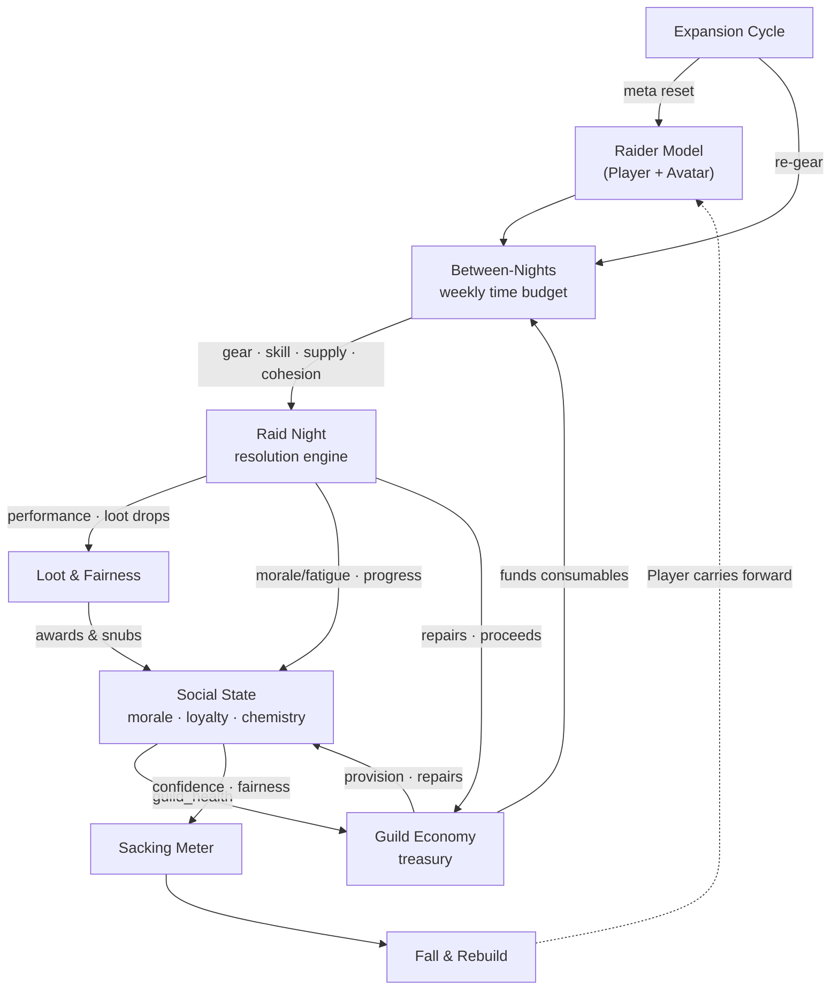

# Guildmaster: Progression Night — Design Overview & Index

The front door to the design doc set: what each doc holds, how the systems interconnect, and the consolidated v1 scope. **Start here.**

## What it is
A Football Manager–style guild-management sim set in a fictional, old-school (Vanilla/TBC-era) fantasy MMO. You run a raiding guild — recruit, gear, train, and hold a ~28-member roster (fixed 20-raider nights) together through slow progression, loot drama, and burnout. PC / Steam, Early Access path. Systems- and text-driven → small-team feasible.

## Doc map
| Doc | Covers |
|---|---|
| **pitch** | One-page pitch: fantasy, core loop, pillars, market. |
| **data-model** | Full ERD (three subject areas), entity reference, lakehouse mapping. |
| **campaign-and-objectives** | Turn loop, calendar, season/expansion structure, save model, objectives (the success system). |
| **resolution** | Raid-night engine: pipeline, checks, difficulty, learning arc, events. |
| **encounter-contracts** | Per-boss tuning contracts (both tiers): expected gear, win bands, dominant failure, signature lever, the gear ceiling. |
| **first-session** | The Night One contract — the curated first session that teaches diagnose → fix → succeed. |
| **presentation** | The raid-night show: notability hierarchy, phase beats, the closing beat, "closest yet". |
| **diagnostics** | Why did we wipe: primary cause vs contributing factors vs key moment; the anti-scapegoat rule. |
| **terminology** | Dual-language UI copy: consequence first, action always, MMO term in parentheses; the glossary. |
| **rating** | The 1–10 performance rating: what it measures, event deltas, no double-counting. |
| **involvement** | Manual / Assisted / Instant per domain; who authors the inputs; the Night One PIN. |
| **raid-prep** | Lineup, comp check, assignments, undermanned/undergeared planning decisions. |
| **gear** | Per-slot equipped gear, gear_score, readiness caps, spec-fit, Marks catch-up. |
| **loot** | Loot & fairness: pluggable policies, the Council claim model, consequences. |
| **between-nights** | Weekly loop: 5 lanes, action resolver, and the guild economy. |
| **recruitment** | Scouting & recruitment: Avatar-visible / Player-hidden, channels, the fog overlay. |
| **conventions** | Modeling patterns (the baseline/current split + convention index). |
| **backlog** | The v1 build plan: phased milestones, DoD grid, critical path. |
| **content-and-dod** | v1 content volume targets + the two Definition-of-Done gates. |
| **naming-bible** | IP-safety rules, slug conventions, the full v1 name set + name generators. |
| **stack-and-tooling** | Engine (Godot 4), data/testing/CI toolchain, art pipeline policy, release path, setup playbook. |
| **v1-readiness-review** | Gap & loophole register (P0–P3) driving kanban setup. *(Historical — all resolved.)* |
| **intervention-and-realignment** | The 2026-07-11 intervention: analysis + decision register (I-01…I-12). *(Historical — all MI closed.)* |
| **post-intervention-assessment** | The post-MI audit that surfaced MC-001 and the doc-defect sweep. *(Historical.)* |
| **phase-a-fun-gate** | The Gate 1 record: the passed verdict, the scorecard, the slice evidence. *(Historical.)* |
| **decisions** | The build-time ADR log (ADR-0001 → present) — what was decided, when, and why. |
| **overview** | This doc. |

## Systems at a glance
- **Raider Model** — two layers. The **Player** (the human: skill, psychology, real-life constraints) persists; the **Avatar** (their character: class, gear, familiarity) is swappable. Personality is hybrid — traits drive the math, authored quirks add special behavior, the archetype label is *derived*.
- **World & Time** — a nested clock: Pull → Raid Night → Week → Season → Expansion → Career. The yearly **expansion** resets gear and the meta — replayability without live-service cost.
- **Raid Night (Resolution)** — a stat-driven probability engine presented as a live combat log. Checks (DPS / heal / tank / mechanic) resolve via `margin → sigmoid`; a per-guild learning arc drives the "8%… 3%… KILL." Every wipe names a check *and* a culprit.
- **Loot & Fairness** — the drama engine. Fairness is per-culture; the loot system you pick sets the yardstick you're judged by. Awards ripple into morale, loyalty, chemistry, and the fairness meter.
- **Between-Nights & Economy** — a weekly time budget across 5 lanes (Gearing / Development / Supply / People / Rest), gated by raider time. The economy funds "the guild provides" via **donations that scale with guild health** — good leadership funds the raid.
- **Social & Drama** — a living graph of morale, drifting loyalty, and pairwise chemistry. Feeds retention, donations, and drama events.
- **Fall & Rebuild** — sustained failure drains officer/member confidence → you're ousted → rebuild from scratch (the Player carries forward). Optional toggle.

## How it all connects

The through-line: **your social management funds and enables your raid capability, and your raid results feed back into your social standing.** No system is an island.

## v1 scope, consolidated
| System | v1 core | Deferred to v1.1+ |
|---|---|---|
| **Raider** | Player+Avatar, 3 skill facets, role proficiency + familiarity, life presets | quirks, chemistry graph, resistance sets, Player-Guildmaster |
| **World / Time** | Season → Week → Raid Night; single expansion | multi-expansion, attunements |
| **Resolution** | contribution → checks → margin/sigmoid, core-5 events, learning arc, rating | resistance & assigned-duty checks, quirk events, full palette, manual jump-in directives |
| **Loot** | Council + DKP + /roll, 7-factor panel, consequence model | Soft-Reserve / EPGP, officer-AI loot policy, faction politics |
| **Between-Nights / Economy** | 5 lanes; treasury (gold/mats/consumables); donation income; 3 policies | professions/crafting, crafting sales, recruitment incentives, knowledge library, collective events |
| **Social / Drama** | morale, loyalty drift, fairness meter | full chemistry graph, DRAMA_EVENT catalogue |
| **Fall / Rebuild** | rebuild loop (toggle) | deeper politics |

## Design pillars (non-negotiables)
- **Legible failure** — nothing is opaque; every outcome names its cause.
- **Fairness is per-culture** — the system you adopt sets the yardstick.
- **Play it your way** — the involvement slider (manual ↔ auto) on both raid night and loot.
- **Sustainable by design** — Rest is a real move; donations aren't a grind; the game rewards not over-grinding.
- **Content as data** — encounters, events, quirks are seed rows; new content = new rows, engine untouched.
- **The Player persists** — re-roll, alts, and sacking carry the human forward.
- **IP-safe** — replicate systems and feel; invent every proper noun.

## Status

> **UPDATE (2026-07-19) — the design phase is long over; this is now a build-status section.** The pre-build status it replaced ("still pending: Phase-A ticket decomposition…") is preserved below, struck through, as the record of where the docs stood when building began.

- **Phase A (M0–M4): shipped.** Schema + migrations, seed kit, roster gen, resolution engine, slice UI. **Gate 1 PASSED 2026-07-12** (Panos: *"hard enough but doable, I feel it just about right"* — see `phase-a-fun-gate.md`).
- **MI (intervention): all 12 tickets closed.** Encounter contracts + retune, check aggregation, curated Night One, presentation, diagnostics, rating, involvement, terminology, per-boss harness + probes, the Fun Gate, Season = Tier alignment, Phase B-lite rescope (Panos approved B-lite 2026-07-18).
- **M5 (the playable week): complete, all 7 tickets.** Genesis · turn loop + calendar · availability + prep decisions · the 5-lane action resolver · inbox + digest + the multi-week proof · save/load · the bench cost. ADRs 0034–0038, 0042–0043.
- **MC-001 (Tier 2): shipped 2026-07-18.** The Spire of the Drowned King — 6 bosses, contracts + probes green in the x1.64→x2.20 band. **The game has 2 raids / 10 bosses across two seasons** (the bible reserves 2 more T1 bosses behind a Panos-gated decision).
- **Availability retuned 2026-07-18** (Panos-approved): evenings field ~19–22 of 28; short weeks are events, not the baseline.
- **Next: M6 — loot** (Council + claims panel + consequences), then M7 economy → M8 recruitment → M9 season stakes. Known recorded gaps: pull inputs still read neutral morale/fatigue instead of the week's snapshots (needs a ticket — balance-sensitive); the main-menu save/load surface (Phase-B screens); loot drops unwritten until M6.
- **Verification state:** 241/241 GdUnit tests · 8 headless smokes · per-boss contract asserts + prep-leverage probes · seed integrity checks · lint/format in CI. Determinism everywhere: same seed + same inputs = same campaign.
- **Stack locked (unchanged):** Godot 4.7 + GDScript + SQLite (`godot-sqlite`) · GdUnit4 + the balance harness · gdtoolkit · GitHub.

~~**Locked & documented:** raider model · world/time · resolution · loot · between-nights/economy · recruitment · campaign & objectives · gear · raid prep · conventions. Data model at v0.8. **P0 blockers: resolved.** **G-register: resolved.** **Still pending:** seed data (naming bible ✅ done — unblocked) · screen map (optional one-pager) · Phase-A ticket decomposition · quirks/drama content → v1.1. **Final build-readiness audit (pass 3): GO.**~~

---

*Index doc — keep in sync as systems evolve.*
